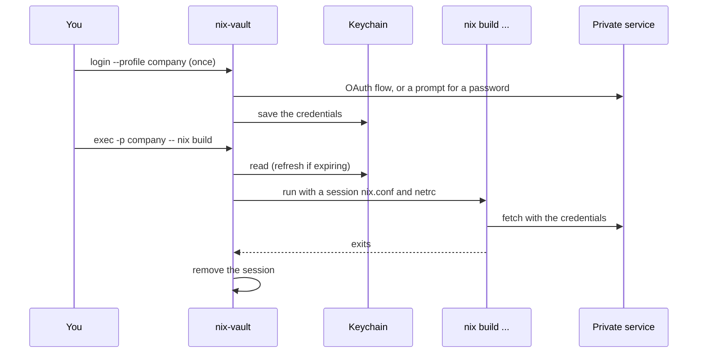

# nix-vault

> Authenticate Nix against private services without keeping credentials in
> `nix.conf` or netrc files: log in once, keep the credentials in your system
> keychain, and run a command with them available to Nix for that command only.
> `aws-vault` for Nix.

[](https://github.com/nixos-contrib/nix-vault/actions/workflows/ci.yml)
[](https://github.com/nixos-contrib/nix-vault/releases/latest)
[](https://www.rust-lang.org/)
[](https://wiki.nixos.org/wiki/Flakes)
[](#install)
[](LICENSE)

> [!WARNING]
> **Pre-1.0.** The configuration file's keys and the command line may still
> change between minor versions.

> [!WARNING]
> **Client-side only.** Credentials reach the Nix commands that `exec` runs. Downloads done
> by the Nix daemon, fetches inside sandboxed builds and remote builders are not covered in
> general: see [Limitations](docs/limitations.md).

```bash
nix-vault login --profile cache                 # once
nix-vault exec -p company -p cache -- nix build # credentials exist only for this command
```

| | Ships as | What it is |
|---|---|---|
| `nix-vault` | A single binary: [GitHub Releases](https://github.com/nixos-contrib/nix-vault/releases), `cargo install`, or `nix run` | The CLI: `login`, `exec`, `logout` and `list`. |
| [`config.toml`](docs/configuration.md) | `~/.config/nix-vault/config.toml` | Profiles: one host and one authentication type each. It never holds a secret. |

## How it works



The credentials live in the keychain. For one `exec` they are written to a private session
directory that is removed when the command ends. `nix.conf` and your netrc are never edited.
Every file and the order of events are in [What `exec` does](docs/delivery.md).

## Do you need it?

| Approach | Where the credential sits | Lifetime | Notes |
|---|---|---|---|
| `access-tokens` in `nix.conf` | Plain text, on disk | Until you edit it | The built-in way; one static token |
| A netrc file | Plain text, on disk | Until you edit it | The built-in way for HTTP downloads and caches |
| **nix-vault** | **Your keychain** | **One command; OAuth tokens refresh** | Device and PKCE logins, a proxy for Cloudflare Access, helper commands |

If one static token in a file you already protect is enough for you, you don't need nix-vault.

## Pick your setup

| You want | Use | Read |
|----------|-----|------|
| A login to a private cache or forge, kept in your keychain | a `basic` or `oauth2` profile | [Configuration](docs/configuration.md) |
| An OAuth provider that publishes metadata | `issuer` instead of the endpoints | [Endpoint discovery](docs/configuration.md#endpoint-discovery) |
| A service behind Cloudflare Access, or one that needs custom headers | the local proxy delivery | [Cloudflare Access](docs/cloudflare-access.md) |
| A token that another tool prints (`cloudflared`, 1Password, a script) | a `process` profile | [Process profiles](docs/process-profiles.md) |
| CI, or a machine with no keychain | environment variables, or the encrypted file store | [CI](docs/ci.md) |

All the guides are in [docs/](docs/README.md).

## Install

```bash
nix run github:nixos-contrib/nix-vault -- --help     # or: nix profile install github:nixos-contrib/nix-vault
cargo binstall nix-vault                             # prebuilt binary from the GitHub release
cargo install nix-vault
```

Supported: macOS and Linux (including NixOS). On Linux the credentials go to the Secret Service
(for example gnome-keyring or KeePassXC), so one must be running in your session. nix-vault never
falls back to another store by itself: without a usable keychain, `login` fails. A machine
without a keychain can use environment variables or an opt-in encrypted file store: see
[CI](docs/ci.md).

## Quick start

1. **Write a profile** in `~/.config/nix-vault/config.toml`:
   ```toml
   [company]
   host = "gitlab.example.com"
   type = "oauth2"

   [company.oauth2]
   client_id = "public-client-id"
   flow = "device"                          # or "authorization_code" (PKCE)
   issuer = "https://gitlab.example.com"    # discover the endpoints, or write them out
   scopes = ["read_api"]
   ```
2. **Log in** once: `nix-vault login --profile company`. A browser step is shown for OAuth; a
   `basic` profile asks for a username and a hidden password or token.
3. **Run Nix** with it: `nix-vault exec -p company -- nix flake update`.
4. **Check** with `nix-vault list`: names, hosts, types and expiry, never a secret.

The file never holds usernames, passwords, access tokens or refresh tokens, and the whole file is
validated before any command runs. A full example is [`config.example.toml`](config.example.toml).

## Commands

```text
nix-vault login  --profile <name> [--force]     store credentials for one profile
nix-vault exec   -p <name> [-p <name>...] -- <command> [args...]
nix-vault logout --profile <name>               remove the stored credentials
nix-vault list                                  names, hosts, types, credentials, expiry
```

What each does, and the exit statuses, are in [Commands](docs/commands.md).

## Development

```bash
nix develop                                   # pinned Rust toolchain
cargo fmt --check && cargo clippy --all-targets -- -D warnings
cargo test                                    # unit + CLI + integration tests
cargo test -- --ignored keyring_smoke         # real keychain round trip (manual)
```

Tests use fake credentials, a scripted mock OAuth provider on a loopback port, a fake `nix` put
first on `PATH` (the tests that need the real `nix` skip themselves when it is absent), and the
encrypted file store with a fake passphrase, so they exercise the same code users run.

Releases are cut by release-please from Conventional Commits. Each release is tagged `vX.Y.Z` and
attaches a binary per platform.

## License

[MIT](LICENSE)
