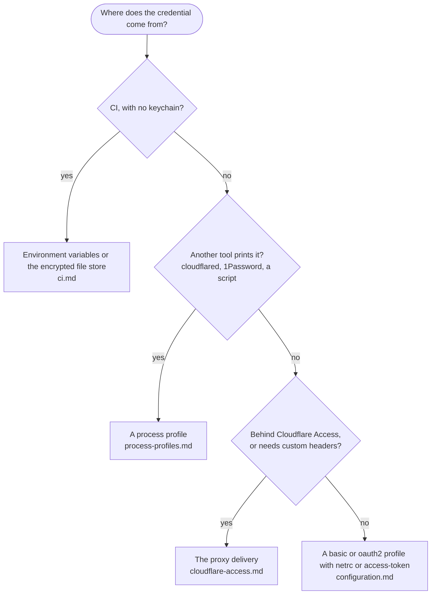

# nix-vault documentation

Which setup is yours?

| Page | What is in it |
|------|---------------|
| [configuration.md](configuration.md) | The config file, profile types and how credentials reach Nix |
| [delivery.md](delivery.md) | What `exec` does to your Nix setup |
| [cloudflare-access.md](cloudflare-access.md) | The reverse proxy: service tokens, OIDC with renewal, custom headers |
| [process-profiles.md](process-profiles.md) | A helper command prints the credential (for example `cloudflared`) |
| [ci.md](ci.md) | Environment variables and the encrypted file store, for runners without a keychain |
| [limitations.md](limitations.md) | What nix-vault does not do, and what is best effort |
