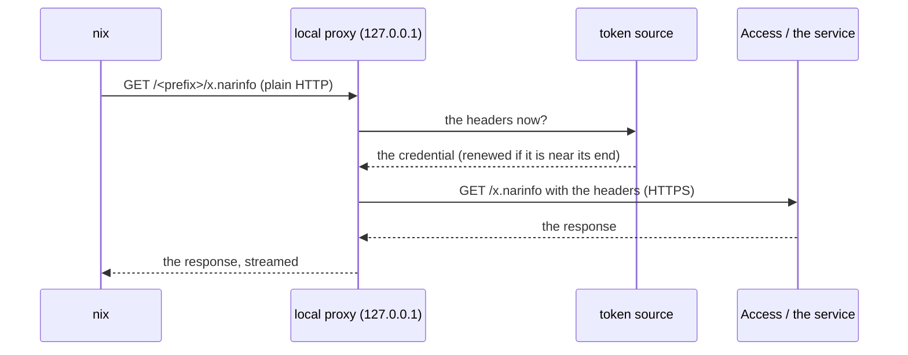

# Services behind Cloudflare Access



Nix can only send an `Authorization` header from netrc: it cannot send the headers Cloudflare
Access wants for a service token. `use = ["proxy"]` covers that:

```toml
[cache]
host = "nix.example.com"
type = "basic"        # login stores the service token: client ID as username, secret as password

[cache.nix]
use = ["proxy"]

[cache.proxy]
headers = { CF-Access-Client-Id = "{username}", CF-Access-Client-Secret = "{password}" }
```

`exec` starts a small reverse proxy on `127.0.0.1` for the length of the command. It forwards each
request over HTTPS to the profile's host, adds the headers of `[<profile>.proxy]`, and streams the bodies, so a large upload or download is never held in memory. The session `nix.conf`
sets `substituters`: the entries for that host now point at the proxy (path and query kept), and the
host is added when you do not list it. Your other substituters are kept.

* **The headers.** `headers` is required with `use = ["proxy"]`. Names are spelled as HTTP spells
  them; values are text in which the placeholders stand for the stored credential, so nothing
  secret is written in the file: `{username}` and `{password}` for basic profiles, `{access_token}`
  for oauth2 profiles. At least one header must use one. The headers that frame a message (`Host`,
  `Content-Length`, ...) cannot be set. A header the client sends with the same name is replaced,
  so `Authorization = "Bearer {access_token}"` works even though Nix itself can only send Basic.
* **The address.** The local URL has a random path prefix, and anything outside it gets a 404, so
  another user on the machine cannot borrow the credentials. It is passed to the command in
  `NIX_VAULT_PROXY_<PROFILE>` (the profile name in capitals), for a command that names the service
  itself: `nix-vault exec -p cache -- nix copy --to "$NIX_VAULT_PROXY_CACHE" ./result`.
* **Permission.** Nix only honors a `substituters` setting from a session if you are allowed to use
  it: a trusted user (`trusted-users`), or the address permitted by `trusted-substituters`.
* **Two ways to get the credential.** A basic profile holds a service token. An oauth2 profile logs
  in through the provider (for Cloudflare, an Access SaaS OIDC application: authorization code with
  PKCE, `redirect_port` set to a registered redirect URL) and the proxy sends the access token as
  configured:

  ```toml
  [cache]
  host = "nix.example.com"
  type = "oauth2"

  [cache.oauth2]
  client_id = "<the application's client ID>"
  flow = "authorization_code"
  authorization_endpoint = "https://<team>.cloudflareaccess.com/cdn-cgi/access/sso/oidc/<client ID>/authorization"
  token_endpoint = "https://<team>.cloudflareaccess.com/cdn-cgi/access/sso/oidc/<client ID>/token"
  scopes = ["openid", "email", "offline_access"]   # offline_access: a refresh token, so the proxy can renew the access token
  redirect_port = 8251

  [cache.nix]
  use = ["proxy"]

  [cache.proxy]
  headers = { Authorization = "Bearer {access_token}" }
  ```
* **Renewal during the run.** The proxy asks for its headers on every request. For an oauth2
  profile it renews the access token when it is within two minutes of its end, exchanging the
  refresh token (and saving a rotated one), so a command that runs longer than the token lives
  keeps working. This needs a refresh token: with Cloudflare Access add `offline_access` to `scopes`
  (the dashboard does not list it, but the API accepts it when the application has a refresh token
  lifetime). Concurrent requests share one renewal. When the token cannot be renewed (the refresh
  token expired or was revoked, or there never was one) the proxy does not forward the request: it
  answers `401` with a message that names the profile and says to run `nix-vault login`. A
  service token (basic profile) does not expire during a run, so its headers never change. Headers
  the client sends that the proxy does not replace are passed on untouched.

How to protect the cache with Cloudflare Access in Terraform (a service token and policies, the
self-hosted application, and the other doors to close) is written up in
[issue #14](https://github.com/nixos-contrib/nix-vault/issues/14#issuecomment-6854749169).
