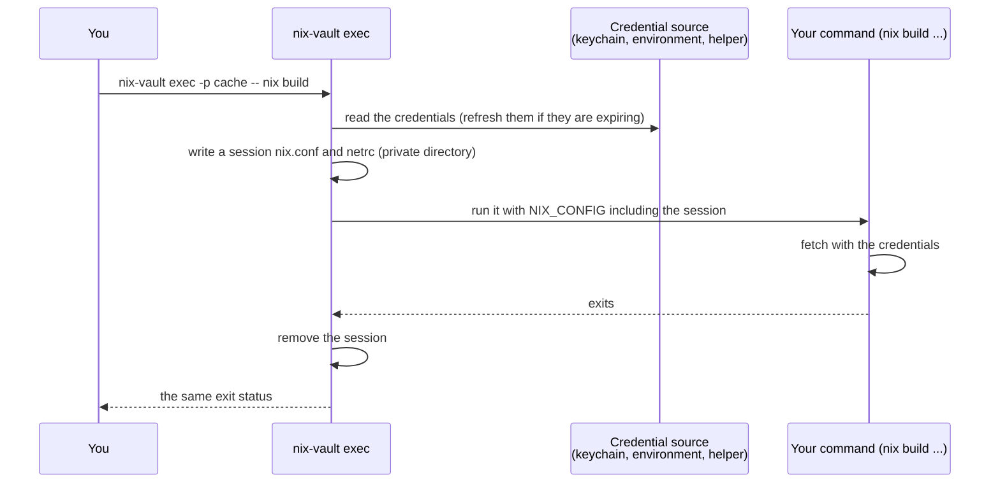

# What `exec` does to your Nix setup

`exec` never edits `nix.conf` or your netrc. It reads your effective Nix settings
(`nix config show --json`), writes a session `nix.conf` and netrc in a private directory
(`<runtime dir>/nix-vault-<uid>/session-*`, mode 0700, files 0600), and extends the command's
`NIX_CONFIG` with one `!include` line. Your existing netrc entries and `access-tokens` are carried
over (the selected profile wins for a host both define, and a note names the host). If your
`netrc-file` exists but cannot be read, the command still runs without its entries and a warning
names the file. The session directory is removed when the command ends. Credentials are never put in
arguments or the environment; with `proxy` the environment holds the local proxy's address, not the
credential.
